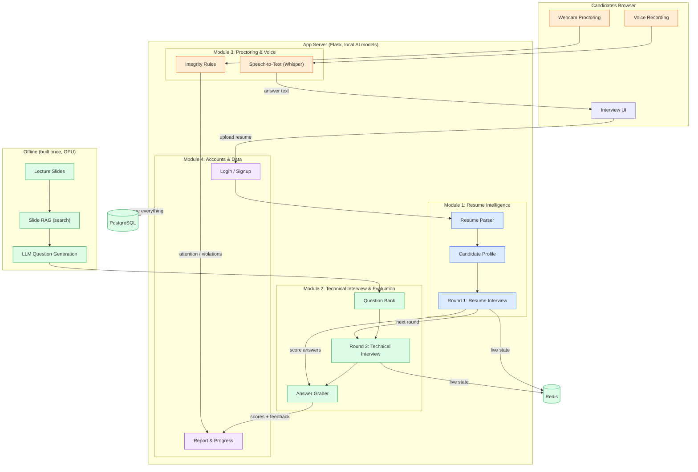

# Architecture diagram: AI Resume-Grounded Interview Platform

Create a **clean architecture diagram** showing the 4 modules, how they connect, and the flow of one interview. Keep it simple: **about 14 boxes**, short labels, clear arrows, no extra detail.

## Layout (top → bottom)

**Row 1: Candidate (browser)**, one wide box at the top:
- "Candidate's Browser". Inside it, 3 small boxes: **"Interview UI"**, **"Webcam Proctoring"** (orange), **"Voice Recording"** (orange).

**Row 2: App Server**, a large container labelled **"App Server (Flask, local AI models)"** holding the 4 modules side by side:

| Module (colour) | Boxes inside, connected left → right with arrows |
|---|---|
| **Module 1: Resume Intelligence** (blue) | "Resume Parser" → "Candidate Profile" → "Round 1: Resume Interview" |
| **Module 2: Technical Interview & Evaluation** (green) | "Question Bank" → "Round 2: Technical Interview" → "Answer Grader" |
| **Module 3: Proctoring & Voice** (orange) | "Integrity Rules" and "Speech-to-Text (Whisper)" |
| **Module 4: Accounts & Data** (purple) | "Login / Signup" and "Report & Progress" |

**Row 3: Storage (Module 2, infrastructure)**, two cylinders at the bottom:
- **"PostgreSQL"**: users, resumes, sessions
- **"Redis"**: interviews in progress

**Left side, separate dashed box: "Offline (built once, GPU)"**
- "Lecture Slides" → "Slide RAG (search)" → "LLM Question Generation" → arrow into **"Question Bank"** in Module 2.

## Arrows between modules (keep only these)

1. Interview UI → **Login / Signup** → **Resume Parser** (label: "upload resume")
2. **Candidate Profile** → **Round 1** (label: "questions from resume")
3. **Round 1** → **Answer Grader** (label: "score answers")
4. **Round 1** → **Round 2** (label: "next round")
5. **Answer Grader** → **Report & Progress** (label: "scores + feedback")
6. **Voice Recording** → **Speech-to-Text** → Interview UI (label: "answer text")
7. **Webcam Proctoring** → **Integrity Rules** → **Report & Progress** (label: "attention score / violations")
8. **Module 4** → **PostgreSQL** (label: "save everything")
9. **Round 1** and **Round 2** → **Redis** (label: "live state")

## Style

- **Look:** flat, modern, white background.
- **Modules:** rounded rectangles, each module a light tint of its colour. Module 1 blue, Module 2 green, Module 3 orange, Module 4 purple.
- **Text and arrows:** large readable sans-serif text; thin dark-grey arrows with small labels.
- **Labels:** each module's title, e.g. "Module 1: Resume Intelligence", in bold at the top of its box.
- **Footer:** a small line at the bottom: "Runs locally with Docker · No paid APIs".
- **Avoid:** icons, people, 3D and extra boxes not listed above.

---

## Optional: the same diagram as Mermaid (for tools that render code)

